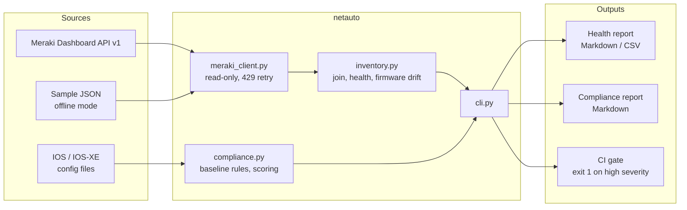
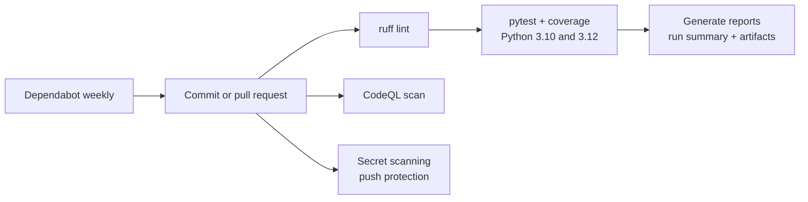

# Architecture

## Delivery pipeline

## Design choices

- **Read-only by design.** The Meraki client only issues GET requests, so it is safe to point at production.
- **Offline client with the same interface.** Tests, demos and CI run with no API key and no network access.
- **Rules as small functions.** Each compliance rule is one line that a network engineer can read and extend.
- **Reports in Markdown.** They render in GitHub, pull requests, the Actions run summary and chat tools without extra tooling.
